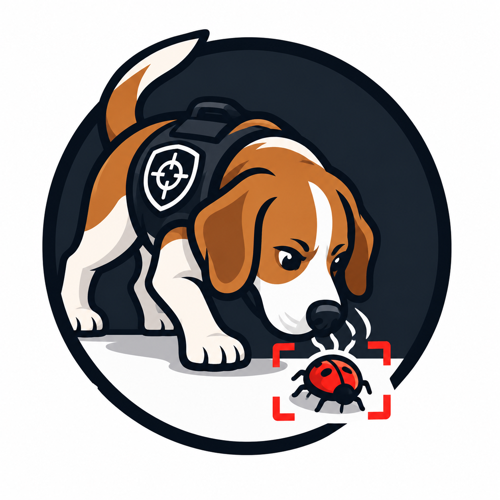
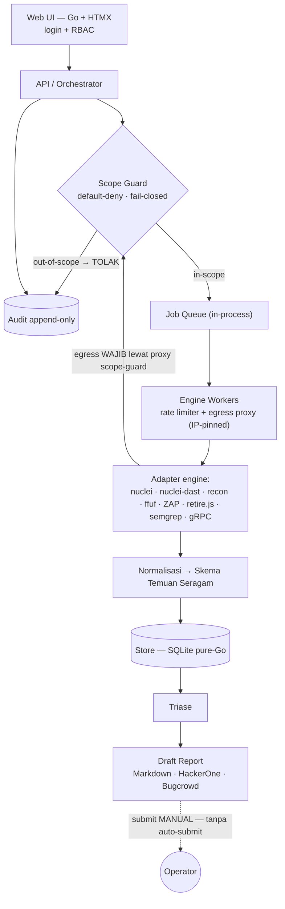
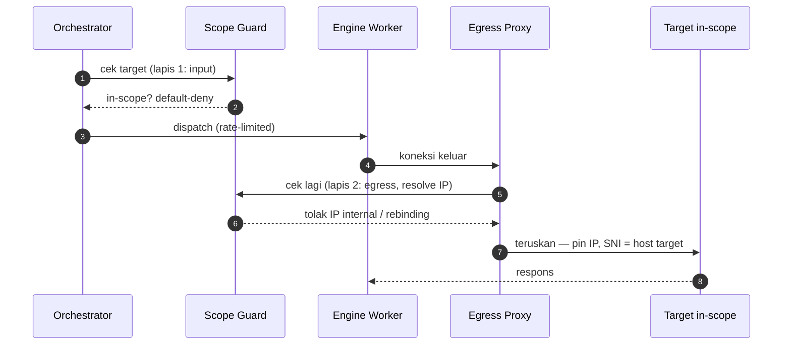

<div align="center">



# bughound

**Bug Bounty DAST Orchestrator** — satu alur kerja, banyak *engine*, satu skema temuan.

<p align="center">
  <a href="https://github.com/Gh05txvx/bughound/actions/workflows/ci.yml"></a>
  <a href="https://github.com/Gh05txvx/bughound/actions/workflows/e2e.yml"></a>
  <a href="https://github.com/Gh05txvx/bughound/tags"></a>
  <a href="LICENSE"></a>
  
  <a href="https://github.com/Gh05txvx/bughound/pkgs/container/bughound"></a>
</p>

*Menyatukan engine recon & DAST yang sudah matang (nuclei, httpx, subfinder, ffuf, ZAP, …) ke satu alur: jalankan terkoordinasi → normalkan ke satu skema temuan → triase → draft report siap verifikasi manual.*

</div>

> [!WARNING]
> **Hanya untuk pengujian yang sah.** bughound adalah alat ofensif (DAST). Gunakan hanya terhadap aset yang berada dalam cakupan (*scope*) program bounty, laboratorium milik sendiri, atau sistem yang telah memberi izin eksplisit. *Scope guard* tolak-bawaan (*default-deny*) menolak target yang tidak terbukti in-scope, dan **tidak ada pengiriman otomatis** — laporan selalu berakhir sebagai draf. Scope guard adalah jaring pengaman, **bukan** izin: memastikan Rules of Engagement mengizinkan *automated scanning* tetap tanggung jawab operator.

---

## Daftar isi

- [Ikhtisar](#ikhtisar)
- [Fitur](#fitur)
  - [Batas kemampuan](#batas-kemampuan)
- [Arsitektur](#arsitektur)
- [Mulai cepat](#mulai-cepat)
  - [Persyaratan](#persyaratan)
  - [Jalankan dengan Docker](#jalankan-dengan-docker)
  - [Jalankan dari sumber](#jalankan-dari-sumber)
- [Login dan peran](#login-dan-peran)
- [Alur kerja](#alur-kerja)
- [Engine yang didukung](#engine-yang-didukung)
- [Fitur lanjutan](#fitur-lanjutan)
  - [Scan terarah OpenAPI/Swagger](#scan-terarah-openapiswagger)
  - [Proxy upstream dan rantai](#proxy-upstream-dan-rantai)
  - [Capture](#capture)
  - [Integrasi Burp Suite](#integrasi-burp-suite)
- [Keamanan](#keamanan)
- [Build dan rilis](#build-dan-rilis)
- [Struktur proyek](#struktur-proyek)
- [Dokumentasi](#dokumentasi)
- [Lisensi](#lisensi)

---

## Ikhtisar

**bughound** adalah *orchestrator* DAST (*Dynamic Application Security Testing*) untuk bug bounty — bukan pemindai baru, melainkan pengatur yang menjalankan sejumlah *engine* recon dan DAST yang sudah matang secara terkoordinasi, menormalkan seluruh hasilnya ke **satu skema temuan seragam**, membantu triase, lalu menyusun **draf laporan** siap diverifikasi manual sebelum diserahkan. Seorang pemburu bug memperoleh keunggulan banyak alat sekaligus tanpa kehilangan konsistensi hasil maupun kendali atas tiap langkah.

- **Untuk siapa** — tim kecil hunter (power user). Antarmuka web, dioptimalkan desktop, UI padat ala tool security (tema gelap).
- **Apa bedanya** — orchestrator, bukan scanner: satu skema temuan untuk semua engine, `dedup_key` deterministik melintasi engine, dan **keamanan sebagai batas struktural** (scope guard, rate limiter, egress ter-guard, audit append-only) — bukan tambahan.
- **Cara pasang** — satu *binary* (Go + HTMX, SQLite pure-Go, CGO off) atau image Docker berisi engine. Lihat [Mulai cepat](#mulai-cepat).

## Fitur

| | Fitur | Ringkas |
| --- | --- | --- |
| 🎯 | **Skema Temuan Seragam** (`BH-SPEC-FINDING`) | Semua engine menormalkan hasil ke satu JSON berversi; `dedup_key` deterministik mengolaps duplikat lintas-engine per program (kolaps site-wide, abaikan path/method sesuai resep). |
| 🛡️ | **Scope Guard dua lapis** (`BH-SPEC-SCOPE`) | Domain / wildcard / URL / IP / CIDR, normalisasi punycode & IP, kebijakan port; dicek saat **input** *dan* saat **egress** (default-deny, out-of-scope menang, fail-closed). |
| 🔌 | **Multi-engine via adapter** | Recon (subfinder → httpx → katana, gau, dnsx, naabu), DAST (nuclei, ffuf + enrichment robots.txt/OpenAPI, ZAP, `nuclei-dast` fuzzing aktif), SCA klien (retire.js), SAST (semgrep), enumerasi gRPC (grpcurl). |
| ⛓️ | **Orchestrator berantre** | scope guard → job queue → engine worker (rate-limited) → normalisasi → store; error satu engine tak menggagalkan run (fail-soft, tercatat di audit). |
| 🔎 | **Triase → draft report** | Konfirmasi / false-positive / abaikan (filter + aksi massal), lengkapi langkah reproduksi & dampak, lalu hasilkan draft (Markdown / cetak-PDF) atau export **HackerOne / Bugcrowd**. |
| 🧩 | **Integrasi Burp Suite** | API JSON baca-saja + extension Montoya menarik temuan ke Burp lalu **Kirim ke Repeater** untuk validasi manual; jalan di **Burp Community**. |
| 🏷️ | **Preset per program** | Simpan preset seleksi template (tags / severity / stealth) per program; otomatis mem-prefill form scan berikutnya. |
| 🔐 | **Lapis keamanan** | Rate limiter wajib di jalur eksekusi, vault secret terenkripsi (disensor dari log & report), audit trail append-only ber-anchor, RBAC (admin/operator/viewer). |
| 📦 | **Satu binary** | UI + seluruh aset di-embed (`go:embed`), SQLite pure-Go (persisten / in-memory), tanpa dependensi runtime. |

### Batas kemampuan

Jujur soal yang **belum** dilakukan bughound — ini desain, bukan bug:

- **Tidak ada auto-submit.** Report selalu berakhir sebagai draf; pengiriman ke platform dilakukan manual oleh operator. Disengaja.
- **Bukan scanner baru.** bughound tidak menemukan apa yang engine di bawahnya tak bisa temukan; kualitas recall mengikuti engine + template yang dipasang.
- **Engine tidak di-bundle ke binary.** Untuk scan nyata, pasang tool-nya sendiri atau pakai image Docker (engine sudah di dalam). Default `-engine mock` tak menyentuh jaringan.
- **OpenAPI = perluasan endpoint.** Tiap endpoint di-expand jadi target (probe + template). Fuzzing per-method/body yang lebih dalam (mis. `nuclei -im openapi`) belum didukung.
- **"Identify your traffic" belum otomatis.** Bila RoE mewajibkan header/User-Agent penanda khusus, engine mengirim UA-nya sendiri — perlu penanganan manual (lihat [`docs/product/BH-DOC-pilot-baseline.md`](docs/product/BH-DOC-pilot-baseline.md) §0.3).
- **Tidak menjadwal sendiri.** Pembatasan jam uji dari RoE dijadwalkan manual oleh operator.
- **Format payload netral sendiri ditunda.** Payload tetap format native engine + satu katalog metadata; format netral tunggal belum dibangun (lihat `BH-SPEC-PAYLOAD`).

## Arsitektur

Alur: `Web UI → API/orchestrator (scope guard) → Job queue → Engine workers (adapter + rate limiter) → Normalisasi/triase → Store`. Hanya **engine workers** yang boleh menjangkau target, dan hanya target **in-scope** (egress terbatas). Report generator menghasilkan draf dari temuan terkonfirmasi.



<details>
<summary><b>Penegakan scope dua lapis (input + egress)</b></summary>

Scope guard ditegakkan dua kali: sekali saat target masuk, sekali lagi saat engine benar-benar membuka koneksi (setelah resolusi DNS, dengan IP di-*pin* untuk mencegah SSRF/DNS-rebinding). Egress tiap engine dipaksa lewat proxy scope-guard bughound.



</details>

**Komponen inti:** Web UI, API/orchestrator, Scope module, Engine adapters, Findings store, Triage module, Report module, Safety layer (rate limiter + audit), Job queue/worker.

## Mulai cepat

### Persyaratan

- **Docker** (jalur termudah untuk scan nyata — engine ikut di image), **atau**
- **Go 1.26+** untuk build/jalankan dari sumber. Mode default `-engine mock` tak butuh tool lain dan tak menyentuh jaringan.

### Jalankan dengan Docker

Engine nyata tidak di-bundle ke binary, jadi cara termudah menjalankan scan nyata **tanpa memasang tool di host** adalah image Docker yang menyatukan bughound + engine (nuclei + template `dast/`, subfinder, httpx, katana, ffuf, semgrep; ZAP & retire.js opsional). Di dalam container semua engine ada di `PATH`.

```bash
# image rilis dari GHCR (varian lean, tanpa ZAP & retire.js)
docker pull ghcr.io/gh05txvx/bughound:latest        # tag versi juga tersedia: :0.3, :0.3.1

# default engine mock (aman), UI di http://127.0.0.1:8787
docker run --rm -p 127.0.0.1:8787:8787 -v bughound-data:/data ghcr.io/gh05txvx/bughound:latest

# scan nyata (engine sudah ada di image); login WAJIB — set kata sandi admin awal
docker run --rm -p 127.0.0.1:8787:8787 -v bughound-data:/data -e BUGHOUND_ADMIN_PASSWORD=rahasia \
  ghcr.io/gh05txvx/bughound:latest -addr 0.0.0.0:8787 -db /data/bughound.db -engine nuclei,ffuf
```

Build sendiri bila perlu ZAP / retire.js:

```bash
docker build -t bughound .                                   # lean (tanpa ZAP/retire)
docker build --build-arg WITH_ZAP=true   -t bughound:zap .   # + OWASP ZAP (berat, +JRE)
docker build --build-arg WITH_RETIRE=true -t bughound:sca .  # + retire.js (Node, SCA klien)
```

Atau `docker compose up --build` (lihat [`docker-compose.yml`](docker-compose.yml); port sudah ke `127.0.0.1`, data di volume).

> [!NOTE]
> Paket GHCR default **privat** saat pertama terbit. Agar bisa `docker pull` tanpa login, set paket `bughound` ke **Public** (GitHub → Packages → bughound → *Package settings* → *Change visibility*), atau tetap privat dan `docker login ghcr.io` dulu. Image GHCR = varian lean; untuk ZAP/retire.js build lokal dengan `--build-arg` di atas.

### Jalankan dari sumber

```bash
go test ./...                 # jalankan seluruh test
go run ./cmd/bughound         # jalankan (simpan ke ./bughound.db)
go run ./cmd/bughound -db ""  # mode in-memory (ephemeral)
```

Buka <http://127.0.0.1:8787> → **login dulu** (lihat [Login dan peran](#login-dan-peran)), isi scope & target, jalankan scan, lalu triase di halaman **Findings**. Form sudah terisi contoh (`demo.test` in-scope, `evil.test` di luar scope) untuk mendemokan scope guard.

<details>
<summary><b>Flag CLI</b></summary>

| Flag | Default | Fungsi |
| --- | --- | --- |
| `-addr` | `127.0.0.1:8787` | Alamat bind (localhost saja secara default). |
| `-db` | `bughound.db` | Path file SQLite; kosongkan untuk in-memory. |
| `-engine` | `mock` | Set engine dipisah koma: `mock` (tanpa jaringan) · `real` · atau daftar `nuclei,ffuf,zap,retire,nuclei-dast`. |
| `-admin-user` / `-admin-password` | — | Akun admin awal saat bootstrap (atau env `BUGHOUND_ADMIN_USER` / `BUGHOUND_ADMIN_PASSWORD`). Password kosong = dibuat acak & dicetak ke konsol sekali. |
| `-no-auth` | off | **Nonaktifkan** login & RBAC (akses terbuka). Hanya untuk localhost tepercaya / test. |
| `-key` | — | Path kunci master enkripsi secret (atau env `BUGHOUND_MASTER_KEY`); `-rotate-key` merotasinya. |
| `-sast-root` | — | Root kode untuk SAST (kosong = nonaktif); analisis statis dikurung ke dir ini (path scope, default-deny). |
| `-ffuf-wordlist` | bawaan | Wordlist untuk engine ffuf nyata. |
| `-zap-mode` | `quick` | Mode ZAP nyata: `quick` · `baseline` · `full` (spider + active scan via Automation Framework). |
| `-grpc` | `mock` | Engine enumerasi gRPC: `mock` · `real` (grpcurl). `-grpc-plaintext` untuk gRPC tanpa TLS. |
| `-nuclei-templates` / `-custom-templates` | auto | Dir template untuk Bank Payload (`BH-SPEC-PAYLOAD`); kosong = auto-deteksi. |
| `-version` | — | Cetak versi build lalu keluar. |

</details>

## Login dan peran

Login **wajib secara default**. Saat pertama dijalankan (belum ada akun), bughound membuat akun **admin** dan **mencetak kata sandinya ke konsol satu kali** — simpan, lalu ganti via halaman **Users**:

```
auth: admin "admin" dibuat — kata sandi: qCn1QHMZFboyml_C
auth: SIMPAN kata sandi di atas; tak akan ditampilkan lagi. Ganti via halaman Users.
```

Browser mendapat **halaman login ber-logo** (sesi cookie `HttpOnly`+`SameSite=Strict`, tombol **Keluar**); otomasi/CLI boleh pakai **HTTP Basic** (username+password akun). Tiga peran:

| Peran | Hak |
| --- | --- |
| **admin** | Semua, termasuk kelola pengguna (halaman **Users**). |
| **operator** | Jalankan scan, triase, kelola program & capture (tak bisa kelola user). |
| **viewer** | Hanya baca (dashboard, findings, report, audit). |

## Alur kerja

1. **Jalankan & login** — `go run ./cmd/bughound` (atau Docker) → login dengan akun admin yang kata sandinya tercetak di konsol → buka <http://127.0.0.1:8787>. Default engine **mock**: tanpa jaringan, aman dicoba.
2. **Programs** — buat program & isi **scope** (in-scope + out-of-scope), diketik atau **diimpor** dari HackerOne (Download CSV / API) dan Bugcrowd. Hasil impor mengisi form untuk ditinjau, baru berlaku setelah disimpan. Semua target dicek scope guard (default-deny).
3. **Scan** — pilih program, isi target/seed (atau tempel spec **OpenAPI/Swagger**, atau isi **upstream proxy / rantai** bila target mewajibkan) → jalankan. Scan jalan di latar belakang; preset per program mem-prefill seleksi template. Pantau statusnya di tempat.
4. **Capture** *(opsional)* — bughound jadi reverse proxy ke satu target in-scope; browsing manual lewat listener lokal, lalu **promote** endpoint terekam jadi scan.
5. **gRPC / SAST** *(opsional)* — enumerasi + fuzz gRPC, atau analisis statis kode lokal (`-sast-root`).
6. **Findings** — triase temuan (konfirmasi / false-positive / abaikan; filter + aksi massal) dan **lengkapi draft** tiap temuan (langkah reproduksi + dampak). Validasi manual bisa langsung dari **Burp** (lihat [Integrasi Burp Suite](#integrasi-burp-suite)).
7. **Reports** — hasilkan **draft** report dari temuan terkonfirmasi (Markdown / cetak-PDF) atau export ke template **HackerOne / Bugcrowd**. Submit tetap **manual** (tanpa auto-submit).
8. **Audit** — jejak keputusan scope + aktivitas (append-only, ter-anchor).

> [!TIP]
> Untuk scan **nyata**, pasang engine (lihat [Engine yang didukung](#engine-yang-didukung)) atau pakai image Docker (engine sudah di dalam), lalu jalankan `-engine real`. Tetap **hanya target in-scope** yang disentuh.

## Engine yang didukung

bughound adalah **orchestrator**, bukan scanner: engine recon/DAST/SAST **tidak di-bundle** ke dalam binary. Untuk scan nyata, pasang sendiri tool-nya, lalu bughound memanggilnya sebagai subprocess dan menegakkan scope guard, rate limiter, serta egress (koneksi keluar engine dipaksa lewat proxy scope-guard bughound). **Default `-engine mock`** tak butuh tool apa pun dan tak menyentuh jaringan.

| Engine | Peran | Adapter | Pasang |
| --- | --- | --- | --- |
| **nuclei** | DAST (template) | mock + nyata | `go install github.com/projectdiscovery/nuclei/v3/cmd/nuclei@latest` |
| **subfinder → httpx → katana** | recon (subdomain → probe → crawl) | mock + nyata | `go install github.com/projectdiscovery/{subfinder/v2/cmd/subfinder,httpx/cmd/httpx,katana/cmd/katana}@latest` |
| **gau** | recon (URL historis, pasif) | mock + nyata | `go install github.com/lc/gau/v2/cmd/gau@latest` |
| **dnsx** | recon (resolusi/validasi DNS) | mock + nyata | `go install github.com/projectdiscovery/dnsx/cmd/dnsx@latest` |
| **naabu** | recon (port scan TCP) | mock + nyata | `go install github.com/projectdiscovery/naabu/v2/cmd/naabu@latest` (butuh libpcap) |
| **ffuf** | DAST (content discovery) | mock + nyata | `go install github.com/ffuf/ffuf/v2@latest` · wordlist bawaan (override `-ffuf-wordlist`) |
| **ZAP** | DAST (proxy scanner) | mock + nyata | [OWASP ZAP](https://www.zaproxy.org/download/) (`zap.sh` di PATH) · `-zap-mode quick\|baseline\|full` |
| **nuclei-dast** | DAST (fuzzing aktif: SQLi/XSS/SSTI/…) | nyata | — pakai `nuclei` + `katana` + template `dast/` · `-engine …,nuclei-dast` |
| **retire.js** | SCA (library JS sisi-klien) | nyata | `npm i -g retire` (Node 18+) · image: `--build-arg WITH_RETIRE=true` · `-engine …,retire` |
| **semgrep** | SAST | mock + nyata | `pipx install semgrep` · aktif via `-sast-root` |
| **grpcurl** | gRPC (enumerasi + fuzz invokasi) | mock + nyata | `go install github.com/fullstorydev/grpcurl/cmd/grpcurl@latest` · `-grpc real` |

Mengaktifkan engine nyata lewat flag `-engine` (daftar dipisah koma):

```bash
go run ./cmd/bughound -engine real                       # nuclei + recon nyata
go run ./cmd/bughound -engine nuclei,ffuf                # ffuf pakai wordlist bawaan
go run ./cmd/bughound -engine nuclei,ffuf -ffuf-wordlist /path/wordlist.txt
go run ./cmd/bughound -engine nuclei,zap -zap-mode full  # + ZAP spider & active scan
go run ./cmd/bughound -engine nuclei,nuclei-dast,retire  # + fuzzing aktif & SCA klien JS
go run ./cmd/bughound -sast-root /path/ke/repo           # aktifkan SAST (semgrep)
```

`mock` (default) menjalankan versi mock semua engine (tanpa jaringan). Menambah engine baru = menulis **satu adapter** (bangun argumen → subprocess `ProxyAware` → `Parse` ke skema temuan); lihat `internal/engine/*` dan `internal/sast`.

## Fitur lanjutan

### Scan terarah OpenAPI/Swagger

Di form **Scan**, tempel spec **OpenAPI 3 / Swagger 2** (JSON atau YAML) pada kolom *OpenAPI/Swagger spec*. Tiap endpoint di `paths` diperluas jadi target konkret (param `{id}` → `1`, base dari `servers`/`host` atau target pertama), lalu **masing-masing tetap melewati scope guard** sebelum di-scan engine. Ini membuat scan menjangkau seluruh endpoint API yang didokumentasikan, bukan hanya hasil crawling.

> [!NOTE]
> Ini memperluas endpoint sebagai target (probe + template engine). Fuzzing per-method/body yang lebih dalam (mis. `nuclei -im openapi`) belum didukung. Untuk **gRPC**, lihat halaman **gRPC** (enumerasi layanan/metode via reflection + fuzz invokasi opt-in: memanggil metode read-only tanpa kredensial untuk mendeteksi akses tanpa autentikasi; metode mutasi dilewati).

### Proxy upstream dan rantai

Sebagian target mewajibkan lalu lintas lewat proxy tertentu, atau kamu ingin melewatkan traffic lewat Burp/ZAP, proxy korporat, atau SOCKS5/Tor. Isi kolom **Upstream proxy / rantai** di form Scan — **satu hop per baris** (urut); satu baris = proxy tunggal, beberapa baris = **rantai** multi-hop. Skema: `http://`, `https://`, `socks5://` (kredensial via `user:pass@host`).

```
http://127.0.0.1:8080      # hop 1 (mis. Burp)
socks5://127.0.0.1:9050    # hop 2 (mis. Tor)
```

Alur: `engine → proxy egress bughound (scope guard + pin IP) → hop1 → hop2 → … → target`. **Keamanan tetap utuh** — scope guard & IP-pinning (anti-SSRF/rebinding) berjalan **sebelum** diteruskan; rantai hanya mengganti jalur ke IP yang sudah dicek. Hop tak valid = **fail-closed** (scan tak jalan).

### Capture

Halaman **Capture** menjadikan bughound **reverse proxy ke satu target in-scope**: pilih program + target, bughound membuka listener lokal, lalu arahkan browser/tool ke situ dan browsing target seperti biasa. Tiap request yang lewat **direkam** (dedup, dengan status) sebagai kandidat endpoint; centang yang relevan lalu **Promote → scan** (masuk jalur scan yang sama: scope guard + rate limiter + engine).

```
1. Programs → simpan scope program (mis. in-scope: app.demo.test)
2. Capture → Program=demo, Target=app.demo.test → Mulai capture
3. Arahkan browser ke http://127.0.0.1:<port>/ → browsing target
4. Segarkan kandidat → centang endpoint → Promote → scan
```

Gateway memakai transport egress ter-guard yang sama (resolve → tolak IP internal → **pin IP**, bisa ikut rantai upstream), target divalidasi scope guard saat start (**default-deny, fail closed**), dan tiap penerusan **di-scope-check ulang + rate-limited** → **hanya host in-scope** yang pernah diteruskan, bahkan saat browsing manual. Listener loopback bicara HTTP biasa; re-originasi ke target HTTPS ditangani di balik layar (SNI = host target, IP di-pin) → **tak perlu pasang CA cert**. Aktivitas tercatat di Audit (`capture.start/stop/promote`, serta penolakan `capture.egress`).

### Integrasi Burp Suite

Alur bughound berakhir pada **verifikasi manual**: tool menemukan kandidat bug, kamu memvalidasinya di Burp. Integrasi ini menjembatani keduanya lewat dua bagian:

- **API JSON baca-saja** — `GET /api/v1/findings?program=<nama>` (opsi `run_id`, `status`, `severity` dipisah koma, `include_duplicates=1`) dan `GET /api/v1/findings/{id}` (lengkap, termasuk `evidence.request`). Auth **HTTP Basic** dengan akun bughound (GET, tanpa CSRF); tanpa kredensial → `401`. Berguna juga untuk skrip/otomasi lain.
- **Extension Burp (Montoya)** di [`burp-ext/`](burp-ext/README.md) — menarik temuan satu program ke tab **bughound** di dalam Burp, lalu **Kirim ke Repeater** (request direkonstruksi dari `evidence.request`, atau fallback GET ke URL lokasi) untuk kamu tekan **Send** sendiri.

> [!TIP]
> **Jalan di Burp Community** — kamu *belum butuh Pro*. Repeater dan memuat extension `.jar` sendiri tersedia di Community; Pro hanya perlu untuk active scanner, Intruder penuh, atau simpan project.

```bash
# 1. build extension (butuh JDK 17+ & Gradle 8+)
cd burp-ext && gradle shadowJar          # -> build/libs/bughound-burp.jar

# 2. Burp -> Extensions -> Add -> type Java -> pilih jar -> muncul tab "bughound"

# 3. di tab bughound: isi URL bughound + user/pass + nama program -> Muat temuan
#    -> pilih baris -> Kirim ke Repeater -> tekan Send untuk validasi

# (opsional) tarik temuan via skrip, tanpa extension:
curl -u admin:PASSWORD 'http://127.0.0.1:8787/api/v1/findings?program=nama-program'
```

Onboarding lengkap (endpoint + contoh `curl` siap-salin + langkah build/load) ada di menu **Burp** pada UI (`/burp`) dan di [`burp-ext/README.md`](burp-ext/README.md).

## Keamanan

Keamanan adalah **batas struktural, bukan tambahan**. Prinsip yang mengikat seluruh repo:

- **Scope guard** sebagai satu titik penegakan wajib (default-deny, out-of-scope menang, fail-closed), ditegakkan **dua lapis** (input + egress). Tak ada jalur sampingan.
- **Tidak pernah memicu koneksi ke aset di luar scope** — termasuk saat development, testing, atau debugging. Gunakan target dummy milik sendiri + mock engine.
- **Tidak ada auto-submit** — report selalu draft, dikirim manual oleh pengguna.
- **Rate limiter** ada di jalur eksekusi dan tidak mudah dimatikan.
- **Secret terenkripsi & terisolasi** — disensor dari evidence/raw sebelum disimpan; tidak pernah bocor ke store/log/report, dan tidak pernah di-commit.
- **Audit trail utuh** (append-only, ber-anchor); tidak bisa dihapus diam-diam.
- **Satu skema temuan seragam** sebagai fondasi; semua engine menulis ke sana.

> [!IMPORTANT]
> Scope guard menegakkan **DI MANA** (in/out), bukan **APAKAH otomasi diizinkan**: sebuah aset bisa in-scope tapi program tetap melarang scanner. Keputusan izin *automated scanning* dibaca manusia dari Rules of Engagement — lihat lembar [`docs/product/BH-DOC-pilot-baseline.md`](docs/product/BH-DOC-pilot-baseline.md) §0. Saat diakses dari luar localhost, taruh di belakang TLS (agar HTTP Basic tak lewat polos) dan **jangan** pakai `-no-auth`. Petakan port Docker ke `127.0.0.1` saja.

## Build dan rilis

Seluruh aset (template + static + HTMX) di-embed lewat `go:embed` dan SQLite-nya pure-Go, jadi tiap rilis adalah **satu binary** tanpa dependensi runtime (CGO off, cross-compile bersih).

```bash
make build                    # binary lokal -> bin/bughound (versi dari git describe)
make release                  # cross-compile semua target -> dist/ (+ checksum)
make release VERSION=v0.1.0   # override versi yang di-embed
```

`make release` menghasilkan arsip untuk `linux/{amd64,arm64}`, `darwin/{amd64,arm64}`, dan `windows/amd64` beserta `SHA256SUMS.txt`. Versi di-inject ke binary (`-ldflags -X main.version`) dan tampil di footer UI serta `bughound -version`.

Push tag `vX.Y.Z` memicu dua workflow: [`release.yml`](.github/workflows/release.yml) (test → build semua target → GitHub Release berisi arsip + checksum) dan [`docker.yml`](.github/workflows/docker.yml) (build & push image gabungan ke GHCR).

```bash
git tag -a v0.1.0 -m "bughound v0.1.0"
git push origin v0.1.0
```

## Struktur proyek

```
cmd/bughound/        entry point (web server)
internal/
  finding/           skema temuan seragam
  scope/             scope guard
  store/             persistensi (interface + Mem + SQLite)
  engine/            kontrak engine + adapter (nuclei, nuclei-dast, ffuf, zap, retire, recon) + mock
  sast/              analisis statis sebagai plugin (registry + mock + semgrep)
  orchestrator/      alur scan dengan penegakan scope dua lapis
  web/               UI (Go + HTMX + template, aset di-embed) + API baca-saja /api/v1
burp-ext/            extension Burp Suite (Montoya) — tarik temuan → Repeater
docs/                spesifikasi, PRD, design spec, persona (lihat docs/README.md)
```

## Dokumentasi

Spesifikasi fondasi dan dokumen produk ada di [`docs/`](docs/README.md): skema temuan (`BH-SPEC-FINDING`), scope guard (`BH-SPEC-SCOPE`), bank payload (`BH-SPEC-PAYLOAD`), PRD, design spec, dan persona kerja.

## Lisensi

[MIT](LICENSE) © 2026 Gh05t
