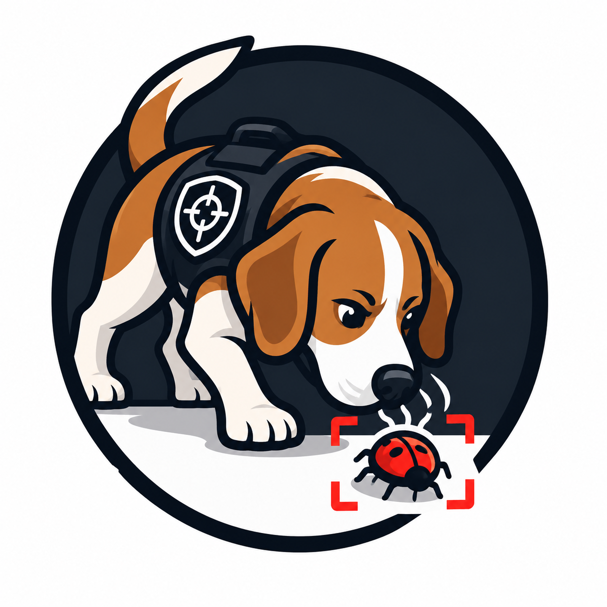
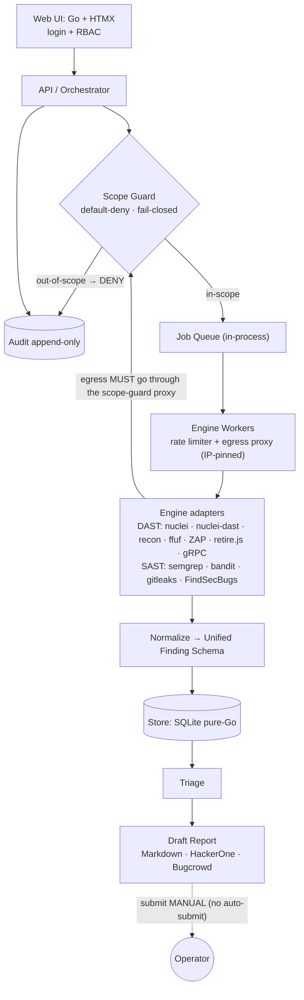
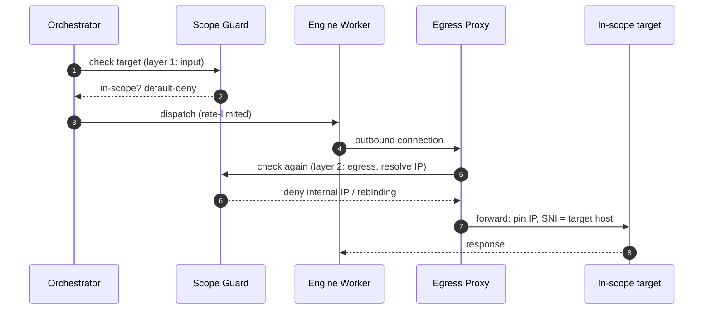

<div align="center">



# BugHound

**Bug Bounty DAST + SAST Orchestrator**: one workflow, many *engines* (dynamic & static testing), one finding schema.

<p align="center">
  <a href="https://github.com/Gh05txvx/bughound/actions/workflows/ci.yml"></a>
  <a href="https://github.com/Gh05txvx/bughound/actions/workflows/e2e.yml"></a>
  <a href="https://github.com/Gh05txvx/bughound/tags"></a>
  <a href="LICENSE"></a>
  
  <a href="https://github.com/Gh05txvx/bughound/pkgs/container/bughound"></a>
</p>

*Brings mature recon, DAST, and SAST engines (nuclei, httpx, subfinder, ffuf, ZAP, semgrep, bandit, gitleaks, …) into one flow: run them in coordination, normalize to one finding schema, triage, then draft a report ready for manual verification.*

</div>

> [!WARNING]
> **Authorized testing only.** BugHound is an offensive tool (DAST). Use it only against assets that are in the *scope* of a bounty program, your own lab, or systems that have given explicit permission. The default-deny *scope guard* rejects targets that are not proven in-scope, and there is **no automatic submission**: reports always end as a draft. The scope guard is a safety net, **not** permission: making sure the Rules of Engagement allow *automated scanning* is still the operator's responsibility.

---

## Table of contents

- [Overview](#overview)
- [Features](#features)
  - [Capability limits](#capability-limits)
- [Architecture](#architecture)
- [Quick start](#quick-start)
  - [Requirements](#requirements)
  - [Run with Docker](#run-with-docker)
  - [Run from source](#run-from-source)
- [Login and roles](#login-and-roles)
- [Workflow](#workflow)
- [DAST & recon engines](#dast--recon-engines)
- [SAST: static code analysis](#sast-static-code-analysis)
- [Advanced features](#advanced-features)
  - [OpenAPI/Swagger-directed scan](#openapiswagger-directed-scan)
  - [Upstream proxy and chains](#upstream-proxy-and-chains)
  - [Capture](#capture)
  - [Burp Suite integration](#burp-suite-integration)
- [Security](#security)
- [Build and release](#build-and-release)
- [Project structure](#project-structure)
- [Documentation](#documentation)
- [License](#license)

---

## Overview

**BugHound** is an application-security testing *orchestrator* for bug bounty that brings **DAST** (*Dynamic Application Security Testing*, testing a **running** application) and **SAST** (*Static Application Security Testing*, analyzing the **source code**) into one flow. It is an orchestrator, not a new scanner: it runs several mature recon, DAST, and SAST engines in a coordinated way, normalizes all of their results into **one unified finding schema**, helps triage, then drafts a **report** ready for manual verification before submission. A bug hunter gets the strength of many tools at once, testing the live application *and* its source code, without losing result consistency or control over each step.

- **Who it is for**: a small team of hunters (power users). A web interface, desktop-optimized, a dense security-tool UI (dark theme).
- **What makes it different**: an orchestrator, not a scanner: one finding schema for every engine, a deterministic `dedup_key` across engines, and **security as a structural boundary** (scope guard, rate limiter, guarded egress, append-only audit).
- **How to install**: a single *binary* (Go + HTMX, pure-Go SQLite, CGO off) or a Docker image with the engines. See [Quick start](#quick-start).

## Features

| | Feature | In short |
| --- | --- | --- |
| 🎯 | **Unified Finding Schema** (`BH-SPEC-FINDING`) | Every engine normalizes its results into one versioned JSON; a deterministic `dedup_key` collapses cross-engine duplicates per program (site-wide collapse, ignoring path/method per the recipe). |
| 🛡️ | **Two-layer Scope Guard** (`BH-SPEC-SCOPE`) | Domain / wildcard / URL / IP / CIDR, punycode & IP normalization, a port policy; checked at **input** *and* at **egress** (default-deny, out-of-scope wins, fail-closed). |
| 🔌 | **Multi-engine DAST via adapters** | Recon (subfinder → httpx → katana, gau, dnsx, naabu), DAST (nuclei, ffuf + robots.txt/OpenAPI enrichment, ZAP, `nuclei-dast` active fuzzing), client-side SCA (retire.js), gRPC enumeration (grpcurl). |
| 🔬 | **SAST: static code analysis** | semgrep (many languages), bandit (Python), gitleaks (*secret* detection, values **redacted**), FindSecBugs (JVM bytecode, opt-in), all normalized through a **SARIF 2.1.0 normalizer** (a path ready for CodeQL & other SARIF emitters); fenced to `-sast-root` (default-deny, **no network**). |
| ⛓️ | **Queued orchestrator** | scope guard → job queue → engine workers (rate-limited) → normalization → store; one engine's error does not fail the run (fail-soft, recorded to the audit). |
| 🔎 | **Triage → draft report** | Confirm / false-positive / ignore (filters + bulk actions), fill in reproduction steps & impact, then produce a draft (Markdown / print-PDF) or export to **HackerOne / Bugcrowd**. |
| 🧩 | **Burp Suite integration** | A read-only JSON API + a Montoya extension pull findings into Burp, then **Send to Repeater** for manual validation; runs on **Burp Community**. |
| 🏷️ | **Per-program presets** | Save a template-selection preset (tags / severity / stealth) per program; it auto-prefills the next scan form. |
| 🔐 | **Security layers** | A mandatory rate limiter in the execution path, an encrypted secret vault (redacted from logs & reports), an append-only anchored audit trail, RBAC (admin/operator/viewer). |
| 📦 | **One binary** | The UI + all assets are embedded (`go:embed`), pure-Go SQLite (persistent / in-memory), no runtime dependencies. |

### Capability limits

An honest account of what BugHound does **not** do yet, this is by design, not a bug:

- **No auto-submit.** A report always ends as a draft; submission to a platform is done by the operator by hand. Deliberate.
- **Not a new scanner.** BugHound does not find what the engines beneath it cannot find; recall quality follows the engines + templates you install.
- **Engines are not bundled into the binary.** For a real scan, install the tools yourself or use the Docker image (the engines are inside). The `-engine mock` default touches no network.
- **OpenAPI = endpoint expansion.** Each endpoint is expanded into a target (probe + templates). Deeper per-method/body fuzzing (e.g. `nuclei -im openapi`) is not supported yet.
- **"Identify your traffic" is not automatic yet.** When the RoE requires a marker header/User-Agent, the engine sends its own UA, so this needs manual handling.
- **It does not schedule itself.** Testing-window limits from the RoE are scheduled by the operator by hand.
- **A neutral payload format is on hold.** Payloads stay in each engine's native format + one metadata catalog; a single neutral format is not built yet (see `BH-SPEC-PAYLOAD`).

## Architecture

Flow: `Web UI → API/orchestrator (scope guard) → Job queue → Engine workers (adapters + rate limiter) → Normalization/triage → Store`. Only the **engine workers** may reach a target, and only an **in-scope** target (limited egress). The report generator produces a draft from confirmed findings.



<details>
<summary><b>Two-layer scope enforcement (input + egress)</b></summary>

The scope guard is enforced twice: once when a target comes in, and again when the engine actually opens a connection (after DNS resolution, with the IP *pinned* to prevent SSRF/DNS-rebinding). Each engine's egress is forced through BugHound's scope-guard proxy.



</details>

**Core components:** Web UI, API/orchestrator, Scope module, Engine adapters, Findings store, Triage module, Report module, Safety layer (rate limiter + audit), Job queue/worker.

## Quick start

### Requirements

- **Docker** (the easiest path for a real scan, the engines ship in the image), **or**
- **Go 1.26+** to build/run from source. The default `-engine mock` mode needs no other tool and touches no network.

### Run with Docker

The real engines are not bundled into the binary, so the easiest way to run a real scan **without installing tools on the host** is the Docker image that bundles BugHound + the engines. One **multi-target** `Dockerfile` produces three images: **`full`** (DAST + SAST, default), **`dast`** (recon + DAST only), and **`sast`** (SAST only, no network). In `full`/`dast`: nuclei + the `dast/` templates, subfinder, httpx, katana, ffuf, `nuclei-dast` (ZAP & retire.js optional). In `full`/`sast`: semgrep, bandit, gitleaks (FindSecBugs optional). Inside the container every tool is on `PATH`.

```bash
# release image from GHCR (lean variant, no ZAP & retire.js)
docker pull ghcr.io/gh05txvx/bughound:latest        # full = DAST + SAST; version tags: :0.5, :0.5.0
docker pull ghcr.io/gh05txvx/bughound:latest-dast   # recon + DAST only (also :0.5.0-dast)
docker pull ghcr.io/gh05txvx/bughound:latest-sast   # SAST only         (also :0.5.0-sast)

# default mock engines (safe), UI at http://127.0.0.1:8787
docker run --rm -p 127.0.0.1:8787:8787 -v bughound-data:/data ghcr.io/gh05txvx/bughound:latest

# real scan (engines already in the image); login REQUIRED, set the initial admin password
docker run --rm -p 127.0.0.1:8787:8787 -v bughound-data:/data -e BUGHOUND_ADMIN_PASSWORD=changeme \
  ghcr.io/gh05txvx/bughound:latest -addr 0.0.0.0:8787 -db /data/bughound.db -engine nuclei,ffuf
```

Build it yourself when you need ZAP / retire.js:

```bash
docker build -t bughound .                                        # full: DAST + SAST (default target)
docker build --target dast -t bughound:dast .                     # recon + DAST only
docker build --target sast -t bughound:sast .                     # SAST only (no network)
docker build --build-arg WITH_ZAP=true         -t bughound:zap .  # + OWASP ZAP (heavy, +JRE)
docker build --build-arg WITH_RETIRE=true      -t bughound:sca .  # + retire.js (Node, client-side SCA)
docker build --build-arg WITH_FINDSECBUGS=true -t bughound:jvm .  # + FindSecBugs (JRE, SAST on JVM bytecode)
```

Or `docker compose up --build` (see [`docker-compose.yml`](docker-compose.yml); the port is already on `127.0.0.1`, data in a volume).

> [!NOTE]
> The GHCR package is **private** by default when first published. To `docker pull` without logging in, set the `bughound` package to **Public** (GitHub → Packages → bughound → *Package settings* → *Change visibility*), or keep it private and `docker login ghcr.io` first. The GHCR image is the lean variant (main tag `full` = DAST + SAST, plus `-dast` & `-sast`); for ZAP / retire.js / FindSecBugs build locally with the `--build-arg` above.

### Run from source

```bash
go test ./...                 # run the whole test suite
go run ./cmd/bughound         # run (saves to ./bughound.db)
go run ./cmd/bughound -db ""  # in-memory mode (ephemeral)
```

Open <http://127.0.0.1:8787> → **log in first** (see [Login and roles](#login-and-roles)), fill in the scope & targets, run the scan, then triage on the **Findings** page. The form is prefilled with examples (`demo.test` in-scope, `evil.test` out-of-scope) to demo the scope guard.

<details>
<summary><b>CLI flags</b></summary>

| Flag | Default | What it does |
| --- | --- | --- |
| `-addr` | `127.0.0.1:8787` | Bind address (localhost only by default). |
| `-db` | `bughound.db` | SQLite file path; leave empty for in-memory. |
| `-engine` | `mock` | Comma-separated engine set: `mock` (no network) · `real` · or a list `nuclei,ffuf,zap,retire,nuclei-dast`. |
| `-admin-user` / `-admin-password` | none | The initial admin account at bootstrap (or env `BUGHOUND_ADMIN_USER` / `BUGHOUND_ADMIN_PASSWORD`). An empty password = generated at random & printed to the console once. |
| `-no-auth` | off | **Disable** login & RBAC (open access). For a trusted localhost / tests only. |
| `-key` | none | Path to the secret-encryption master key (or env `BUGHOUND_MASTER_KEY`); `-rotate-key` rotates it. |
| `-sast-root` | none | Code root for SAST (empty = disabled); static analysis is fenced to this dir (path-scoped, default-deny). |
| `-ffuf-wordlist` | built-in | Wordlist for the real ffuf engine. |
| `-zap-mode` | `quick` | Real ZAP mode: `quick`/`baseline` (spider + passive, no attack) · `full` (+ active scan via the Automation Framework). |
| `-grpc` | `mock` | gRPC enumeration engine: `mock` · `real` (grpcurl). `-grpc-plaintext` for gRPC without TLS. |
| `-nuclei-templates` / `-custom-templates` | auto | Template dir for the Payload Bank (`BH-SPEC-PAYLOAD`); empty = auto-detect. |
| `-version` | none | Print the build version then exit. |

</details>

## Login and roles

Login is **required by default**. On the first run (no account yet), BugHound creates an **admin** account and **prints its password to the console once**, save it, then change it on the **Users** page:

```
auth: admin "admin" created, password: qCn1QHMZFboyml_C
auth: SAVE the password above; it will not be shown again. Change it on the Users page.
```

The browser gets a **logo'd login page** (an `HttpOnly`+`SameSite=Strict` cookie session, a **Sign out** button); automation/CLI may use **HTTP Basic** (the account's username+password). Three roles:

| Role | Rights |
| --- | --- |
| **admin** | Everything, including user management (the **Users** page). |
| **operator** | Run scans, triage, manage programs & capture (cannot manage users). |
| **viewer** | Read only (dashboard, findings, report, audit). |

## Workflow

1. **Run & log in**: `go run ./cmd/bughound` (or Docker) → log in with the admin account whose password is printed to the console → open <http://127.0.0.1:8787>. The default engine is **mock**: no network, safe to try.
2. **Programs**: create a program & fill in the **scope** (in-scope + out-of-scope), typed or **imported** from HackerOne (Download CSV / API) and Bugcrowd. The import fills the form for review and only takes effect once saved. Every target is checked by the scope guard (default-deny).
3. **Scan**: pick a program, fill in targets/seeds (or paste an **OpenAPI/Swagger** spec, or fill in an **upstream proxy / chain** when the target requires one) → run. The scan runs in the background; the per-program preset prefills the template selection. Watch its status in place.
4. **Capture** *(optional)*: BugHound becomes a reverse proxy to one in-scope target; browse by hand through the local listener, then **promote** the recorded endpoints into a scan.
5. **gRPC / SAST** *(optional)*: enumerate + fuzz gRPC, or statically analyze local code (`-sast-root`).
6. **Findings**: triage findings (confirm / false-positive / ignore; filters + bulk actions) and **complete the draft** for each finding (reproduction steps + impact). Manual validation can go straight from **Burp** (see [Burp Suite integration](#burp-suite-integration)).
7. **Reports**: produce a **draft** report from confirmed findings (Markdown / print-PDF) or export to the **HackerOne / Bugcrowd** templates. Submission stays **manual** (no auto-submit).
8. **Audit**: the trail of scope decisions + activity (append-only, anchored).

> [!TIP]
> For a **real** scan, install the engines (see [DAST & recon engines](#dast--recon-engines)) or use the Docker image (the engines are inside), then run `-engine real`. Still, **only in-scope targets** are touched.

## DAST & recon engines

BugHound is an **orchestrator**, not a scanner: the recon & DAST engines are **not bundled** into the binary. For a real scan, install the tools yourself, then BugHound calls them as a subprocess and enforces the scope guard, rate limiter, and egress (an engine's outbound connection is forced through BugHound's scope-guard proxy). The **`-engine mock` default** needs no tool and touches no network.

| Engine | Role | Adapter | Install |
| --- | --- | --- | --- |
| **nuclei** | DAST (templates) | mock + real | `go install github.com/projectdiscovery/nuclei/v3/cmd/nuclei@latest` |
| **subfinder → httpx → katana** | recon (subdomain → probe → crawl) | mock + real | `go install github.com/projectdiscovery/{subfinder/v2/cmd/subfinder,httpx/cmd/httpx,katana/cmd/katana}@latest` |
| **gau** | recon (historical URLs, passive) | mock + real | `go install github.com/lc/gau/v2/cmd/gau@latest` |
| **dnsx** | recon (DNS resolution/validation) | mock + real | `go install github.com/projectdiscovery/dnsx/cmd/dnsx@latest` |
| **naabu** | recon (TCP port scan) | mock + real | `go install github.com/projectdiscovery/naabu/v2/cmd/naabu@latest` (needs libpcap) |
| **ffuf** | DAST (content discovery) | mock + real | `go install github.com/ffuf/ffuf/v2@latest` · built-in wordlist (override with `-ffuf-wordlist`) |
| **ZAP** | DAST (proxy scanner) | mock + real | [OWASP ZAP](https://www.zaproxy.org/download/) (`zap.sh` on PATH) · `-zap-mode quick\|baseline\|full` |
| **nuclei-dast** | DAST (active fuzzing: SQLi/XSS/SSTI/…) | real | use `nuclei` + `katana` + the `dast/` templates · `-engine …,nuclei-dast` |
| **retire.js** | SCA (client-side JS libraries) | real | `npm i -g retire` (Node 18+) · image: `--build-arg WITH_RETIRE=true` · `-engine …,retire` |
| **grpcurl** | gRPC (enumerate + fuzz invocations) | mock + real | `go install github.com/fullstorydev/grpcurl/cmd/grpcurl@latest` · `-grpc real` |

Enable a real engine with the `-engine` flag (comma-separated list):

```bash
go run ./cmd/bughound -engine real                       # real nuclei + recon
go run ./cmd/bughound -engine nuclei,ffuf                # ffuf with the built-in wordlist
go run ./cmd/bughound -engine nuclei,ffuf -ffuf-wordlist /path/wordlist.txt
go run ./cmd/bughound -engine nuclei,zap -zap-mode full  # + ZAP spider & active scan
go run ./cmd/bughound -engine nuclei,nuclei-dast,retire  # + active fuzzing & client-side JS SCA
go run ./cmd/bughound -sast-root /path/to/repo           # enable SAST (semgrep, bandit, gitleaks)
```

`mock` (default) runs the mock version of every engine (no network). Adding a new engine = writing **one adapter** (build the arguments → `ProxyAware` subprocess → `Parse` into the finding schema); see `internal/engine/*` and `internal/sast`.

## SAST: static code analysis

Besides testing a **running** application (DAST), BugHound statically analyzes the **source code**. The SAST module runs **entirely locally, touching no network**, and is fenced to one directory via `-sast-root` with a **path-scoped default-deny** policy (anything outside the root is denied; a symlink that escapes is blocked), parallel to the DAST scope guard, "security as a structural boundary".

Four engines, all normalized into the **same finding schema** as DAST (severity, CWE, evidence, `dedup_key`), so static and dynamic findings live in the same list, triage, and draft report:

| Engine | Coverage | Notes | Install |
| --- | --- | --- | --- |
| **semgrep** | many languages (patterns) | the `p/default` ruleset is *pre-baked* so it runs **offline** | `pipx install semgrep` |
| **bandit** | Python | `eval`, `shell=True`, MD5, SQL concatenation, flask debug, etc. | `pipx install bandit` |
| **gitleaks** | *secrets* (all files) | the secret value is **always redacted** (`--redact` + an internal safety net), it never reaches a finding/log/report | [gitleaks releases](https://github.com/gitleaks/gitleaks/releases) |
| **FindSecBugs** | JVM bytecode (`.jar`/`.class`) | **opt-in** (needs a JRE + SpotBugs); image `--build-arg WITH_FINDSECBUGS=true` | SpotBugs + the FindSecBugs plugin |

**SARIF 2.1.0 normalizer.** gitleaks & FindSecBugs write **SARIF**; one shared *normalizer* maps it to the finding schema (including numeric `security-severity` → severity, CWE extraction from tags/properties). Because it is generic, adding another SARIF-emitting engine (e.g. **CodeQL**) only takes a thin adapter that calls `NormalizeSARIF`.

**How to run:**

```bash
# enable SAST + fence it to one root (required; without this the SAST menu is off)
go run ./cmd/bughound -sast-root /path/to/repo
# in the sast/full image it is set automatically: BUGHOUND_SAST_ROOT=/data/sast
```

In the UI open the **SAST** menu (`/sast`): fill in a **subpath** (relative to the root) → pick an **engine** (dropdown, one per run) → **Run**. Findings land in the same **Findings** list as DAST (filters, triage, draft report, export).

> [!NOTE]
> SAST reads the code **as is**, it does not *compile*, execute, or reach the network. FindSecBugs analyzes **bytecode**, so the target must already be `.jar`/`.class`; without a JVM artifact the engine returns 0 findings (not an error).

## Advanced features

### OpenAPI/Swagger-directed scan

In the **Scan** form, paste an **OpenAPI 3 / Swagger 2** spec (JSON or YAML) into the *OpenAPI/Swagger spec* field. Each endpoint in `paths` is expanded into a concrete target (a `{id}` param → `1`, the base from `servers`/`host` or the first target), and then **each one still passes the scope guard** before an engine scans it. This lets the scan reach every documented API endpoint, not just what crawling found.

> [!NOTE]
> This expands endpoints as targets (probe + engine templates). Deeper per-method/body fuzzing (e.g. `nuclei -im openapi`) is not supported yet. For **gRPC**, see the **gRPC** page (service/method enumeration via reflection + opt-in invocation fuzzing: calling a read-only method without credentials to detect access without authentication; mutating methods are skipped).

### Upstream proxy and chains

Some targets require traffic through a specific proxy, or you want to route traffic through Burp/ZAP, a corporate proxy, or SOCKS5/Tor. Fill in the **Upstream proxy / chain** field in the Scan form, **one hop per line** (in order); one line = a single proxy, several lines = a multi-hop **chain**. Schemes: `http://`, `https://`, `socks5://` (credentials via `user:pass@host`).

```
http://127.0.0.1:8080      # hop 1 (e.g. Burp)
socks5://127.0.0.1:9050    # hop 2 (e.g. Tor)
```

Flow: `engine → BugHound egress proxy (scope guard + pin IP) → hop1 → hop2 → … → target`. **Security stays intact**: the scope guard & IP-pinning (anti-SSRF/rebinding) run **before** forwarding; the chain only changes the route to an already-checked IP. An invalid hop = **fail-closed** (the scan does not run).

### Capture

The **Capture** page turns BugHound into a **reverse proxy to one in-scope target**: pick a program + target, BugHound opens a local listener, then point your browser/tool at it and browse the target as usual. Each request that passes through is **recorded** (deduplicated, with a status) as an endpoint candidate; check the relevant ones then **Promote → scan** (into the same scan path: scope guard + rate limiter + engines).

```
1. Programs → save the program scope (e.g. in-scope: app.demo.test)
2. Capture → Program=demo, Target=app.demo.test → Start capture
3. Point the browser at http://127.0.0.1:<port>/ → browse the target
4. Refresh the candidates → check endpoints → Promote → scan
```

The gateway uses the same guarded egress transport (resolve → deny internal IP → **pin IP**, can follow the upstream chain), the target is validated by the scope guard at start (**default-deny, fail closed**), and every forward is **re-scope-checked + rate-limited** → **only in-scope hosts** are ever forwarded, even during manual browsing. The loopback listener speaks plain HTTP; re-origination to an HTTPS target is handled behind the scenes (SNI = target host, IP pinned) → **no CA cert needed**. The activity is logged to the Audit (`capture.start/stop/promote`, and `capture.egress` denials).

### Burp Suite integration

BugHound's flow ends in **manual verification**: the tool finds a candidate bug, you validate it in Burp. This integration bridges the two with two parts:

- **Read-only JSON API**: `GET /api/v1/findings?program=<name>` (options `run_id`, `status`, comma-separated `severity`, `include_duplicates=1`) and `GET /api/v1/findings/{id}` (full, including `evidence.request`). Auth is **HTTP Basic** with a BugHound account (GET, no CSRF); without credentials → `401`. Useful for other scripts/automation too.
- **Burp extension (Montoya)** in [`burp-ext/`](burp-ext/README.md): pulls one program's findings into a **BugHound** tab inside Burp, then **Send to Repeater** (the request is rebuilt from `evidence.request`, or a fallback GET to the location URL) for you to press **Send** yourself.

> [!TIP]
> **Runs on Burp Community**: you do *not* need Pro yet. Repeater and loading your own `.jar` extension are available in Community; Pro is only needed for the active scanner, full Intruder, or saving a project.

```bash
# 1. build the extension (needs JDK 17+ & Gradle 8+)
cd burp-ext && gradle shadowJar          # -> build/libs/bughound-burp.jar

# 2. Burp -> Extensions -> Add -> type Java -> pick the jar -> the "BugHound" tab appears

# 3. in the BugHound tab: fill in the BugHound URL + user/pass + program name -> Load findings
#    -> pick a row -> Send to Repeater -> press Send to validate

# (optional) pull findings via a script, without the extension:
curl -u admin:PASSWORD 'http://127.0.0.1:8787/api/v1/findings?program=program-name'
```

The full onboarding (endpoints + copy-ready `curl` examples + build/load steps) is in the **Burp** menu in the UI (`/burp`) and in [`burp-ext/README.md`](burp-ext/README.md).

## Security

Security is a **structural boundary, not an add-on**. The principles that bind the whole repo:

- **Scope guard** as one mandatory enforcement point (default-deny, out-of-scope wins, fail-closed), enforced in **two layers** (input + egress). No side path.
- **Never trigger a connection to an out-of-scope asset**, including during development, testing, or debugging. Use your own dummy targets + mock engines.
- **No auto-submit**: a report is always a draft, submitted by the user by hand.
- **The rate limiter** is in the execution path and not easy to turn off.
- **Secrets are encrypted & isolated**: redacted from evidence/raw before storage; they never leak to the store/log/report, and are never committed.
- **The audit trail is intact** (append-only, anchored); it cannot be quietly deleted.
- **One unified finding schema** as the foundation; every engine writes to it.

> [!IMPORTANT]
> The scope guard enforces **WHERE** (in/out), not **WHETHER automation is allowed**: an asset can be in-scope while the program still forbids a scanner. The *automated scanning* permission is read by a human from the Rules of Engagement (a manual operator decision, outside the technical enforcement). When reached from outside localhost, put it behind TLS (so HTTP Basic does not travel in the clear) and do **not** use `-no-auth`. Map the Docker port to `127.0.0.1` only.

## Build and release

All assets (templates + static + HTMX) are embedded with `go:embed` and the SQLite is pure-Go, so each release is **one binary** with no runtime dependencies (CGO off, clean cross-compile).

```bash
make build                    # local binary -> bin/bughound (version from git describe)
make release                  # cross-compile every target -> dist/ (+ checksums)
make release VERSION=v0.1.0   # override the embedded version
```

`make release` produces archives for `linux/{amd64,arm64}`, `darwin/{amd64,arm64}`, and `windows/amd64` along with `SHA256SUMS.txt`. The version is injected into the binary (`-ldflags -X main.version`) and shows in the UI footer and in `bughound -version`.

Pushing a `vX.Y.Z` tag triggers two workflows: [`release.yml`](.github/workflows/release.yml) (test → build every target → a GitHub Release with the archives + checksums) and [`docker.yml`](.github/workflows/docker.yml) (build & push **3 image variants** (`full` / `dast` / `sast`) to GHCR).

```bash
git tag -a v0.1.0 -m "bughound v0.1.0"
git push origin v0.1.0
```

## Project structure

```
cmd/bughound/        entry point (web server)
internal/
  finding/           unified finding schema
  scope/             scope guard
  store/             persistence (interface + Mem + SQLite)
  engine/            engine contract + adapters (nuclei, nuclei-dast, ffuf, zap, retire, recon) + mock
  sast/              SAST as a plugin (registry + mock + semgrep + bandit + gitleaks + FindSecBugs + SARIF normalizer)
  orchestrator/      scan flow with two-layer scope enforcement
  web/               UI (Go + HTMX + templates, embedded assets) + read-only API /api/v1
burp-ext/            Burp Suite extension (Montoya), pull findings → Repeater
docs/                specs, PRD, design spec, personas (see docs/README.md)
```

## Documentation

The foundational specs and product docs are in [`docs/`](docs/README.md): the finding schema (`BH-SPEC-FINDING`), scope guard (`BH-SPEC-SCOPE`), payload bank (`BH-SPEC-PAYLOAD`), PRD, design spec, and work personas.

## License

[MIT](LICENSE) © 2026 Gh05t
